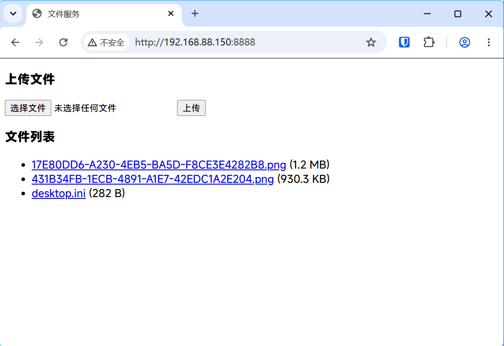

# 极简文件服务（上传 / 下载）

一个基于 Python 标准库实现的极简 HTTP 文件服务，支持在浏览器中上传文件、查看文件列表并下载。无任何第三方依赖，页面不使用任何 CSS 和外网 CDN。



## 功能

- 列出指定目录下的所有文件，并显示文件大小
- 点击文件名即可下载
- 通过浏览器原生 `<input type="file">` 上传文件，上传后保存到指定目录
- 同名文件自动重命名（`文件名_1.后缀`），不会覆盖已有文件
- 页面使用 `<meta name="viewport">`，兼容移动端浏览器
- 监听 `0.0.0.0`，同一局域网内的手机等设备也可访问

## 环境要求

- Python 3（仅使用标准库，无需 `pip install` 任何依赖）

## 文件结构

```
upload_server.py   服务主程序
start.bat          Windows 启动脚本（可选）
README.md          说明文档
```

## 使用方法

### 方式一：启动脚本（Windows）

双击 `start.bat` 即可启动服务。脚本会切换到自身所在目录并运行 `upload_server.py`。

### 方式二：命令行

```bash
python upload_server.py
```

启动后在浏览器访问：

```
http://127.0.0.1:8888/
```

局域网内其他设备访问（将 IP 替换为本机局域网 IP）：

```
http://<本机局域网IP>:8888/
```

按 `Ctrl+C` 停止服务。

## 配置

在 [upload_server.py](upload_server.py) 顶部修改以下常量：

| 常量 | 默认值 | 说明 |
| --- | --- | --- |
| `DIR` | `D:\iMaeGoo\Downloads` | 文件列表与上传保存的目录 |
| `PORT` | `8888` | 服务监听端口 |

修改后重启服务生效。

## 接口说明

| 方法 | 路径 | 说明 |
| --- | --- | --- |
| GET | `/` | 首页，列出文件并提供上传表单 |
| GET | `/files/<文件名>` | 下载指定文件（以附件形式） |
| POST | `/upload` | 上传文件（`multipart/form-data`，字段名 `file`） |

上传成功后返回 `303` 并跳转回首页。

## 注意事项

- **内存占用**：上传内容会被一次性读入内存后写盘，上传超大文件（数 GB）时会占用较多内存。如需上传大文件，可改为分块流式写盘。
- **安全**：文件名经过 `os.path.basename` 过滤，防止路径穿越；但服务对内网完全开放，请勿在不可信网络环境中长期运行。
- **start.bat 编码**：脚本使用 **UTF-8 with BOM + CRLF** 并配合 `chcp 65001`，以保证中文提示正常显示且命令解析正确。如用其他编辑器修改，请保持该编码与行尾格式。
